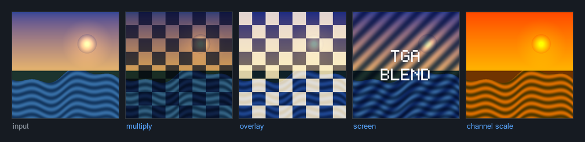
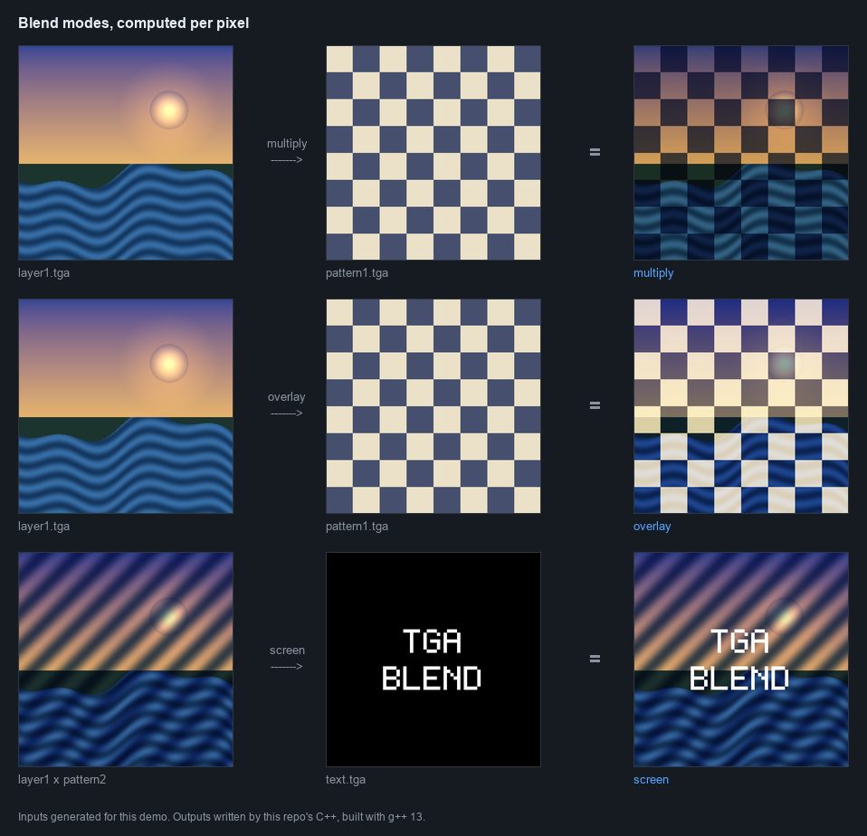
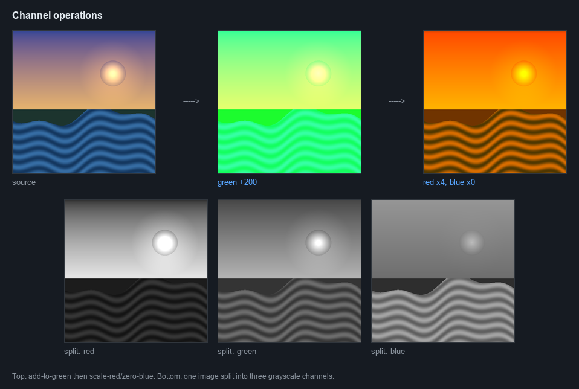

# TGA image processing

**A small imaging library in C++11 that parses the TGA binary format by hand and implements
Photoshop-style blend modes as per-pixel arithmetic. No imaging library, no dependencies.**



---

## What it does

Reads 24-bit uncompressed TGA files, applies operations, writes TGA back out.

**Blend modes** take two images and combine them pixel by pixel:



- `multiply`: normalise both to 0..1, multiply, scale back. Darkens.
- `screen`: invert both, multiply, invert the result. Lightens.
- `overlay`: multiply or screen per pixel depending on whether the lower pixel is below
  or above the midpoint. Boosts contrast while keeping both highlights and shadows.
- `subtract`: straight per-channel difference, clamped at zero.

**Channel operations** work on a single image:



- add a constant to one channel, scale a channel by a factor
- split one image into three grayscale images, one per channel
- recombine three grayscale images into one colour image
- rotate 180 degrees

Every operation runs through one `clamp()` so that arithmetic which overflows past 255 or
below 0 saturates instead of wrapping around, which is the classic way this kind of code
produces psychedelic garbage.

## How it works

The whole thing rests on getting 18 bytes right:

```cpp
#pragma pack(push, 1)
struct Header {
    char  idLength;      char  colorMapType;  char  dataTypeCode;
    short colorMapOrigin; short colorMapLength; char colorMapDepth;
    short xOrigin;       short yOrigin;
    short width;         short height;
    char  bitsPerPixel;  char  imageDescriptor;
};
#pragma pack(pop)
```

`#pragma pack(push, 1)` is the load-bearing line. Without it the compiler inserts padding
to align the `short` fields, the struct becomes 20 bytes instead of 18, and every pixel
afterwards is read from the wrong offset. The pixel data that follows it is stored
**BGR**, not RGB, which is the other thing that silently produces a wrong-but-plausible
image if you assume otherwise.

Pixels live in a flat `std::vector<unsigned char>`, three bytes per pixel, and every
operation is a single pass over it.

## Running it

```bash
g++ -std=c++11 -Wall -Wextra -o project2.out main.cpp image.cpp
mkdir -p output
./project2.out
```

`main.cpp` runs ten fixed tasks against files in `input/` and writes results to `output/`.
Both directories need to exist, and `input/` needs 24-bit uncompressed TGA files named the
way `main.cpp` expects (`layer1.tga`, `pattern1.tga`, `car.tga`, `text.tga`, `circles.tga`,
`layer_red.tga` and friends). They are not in this repo. Any 24-bit uncompressed TGA of
matching dimensions will do; the blend operations assume both images are the same size.

> The `Makefile` in this repo expects sources under `src/`, while they sit at the top
> level, so `make` does not build it as-is. The `g++` line above does.

## Built with

`C++11` · `std::vector` · `std::ifstream` / `std::ofstream` binary I/O · `Makefile`

## The tricky parts

- **Struct padding.** The header struct is read straight out of the file as bytes. The
  moment the compiler is allowed to align the fields, every offset after it is wrong, and
  the symptom is not a crash: it is an image that is subtly skewed or tinted, which is much
  harder to trace back to its cause.
- **Where to clamp.** Blend math has to be done in a wider type and clamped once at the
  end. Clamping an intermediate value, or doing the arithmetic in `unsigned char` directly,
  wraps 260 around to 4 and puts bright speckles in the dark parts of the image.
- **Channel order.** TGA stores pixels as BGR, not RGB. Blending does not care, since it is
  the same operation on every byte, but `scaleColor` very much does: byte 0 of each pixel
  is blue and byte 2 is red, so "scale the red channel" is an operation on `data[i+2]`.
  Get that backwards and the code still runs and still writes a valid image, just the
  wrong one.

## Context

Originally written for COP3503C at the University of Florida, then cleaned up. The
operations and the file format handling are mine; the original course assignment supplied
the test images, which is why they are not committed here.
